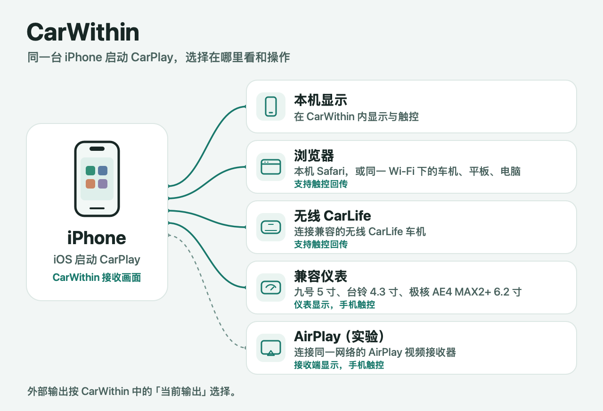

# CarWithin

[English](README.en.md) · **简体中文**

  

CarWithin 在同一台 iPhone 上启动、显示和触控本机 CarPlay。你可以直接在 iPhone 上用导航、音乐等 CarPlay 应用，也可以把画面送到同一局域网的车机浏览器、平板、电脑或另一台手机。浏览器接收支持触控回传。

## 源码测试包提示缺少身份

内置身份安装包会在启动时自动载入身份，Build 21 起设置列表不再显示「CarPlay 身份」。如果原版可以启动，而源码构建包提示「需要导入 MFi 身份」，在主界面点击「配置身份 / 从原版 IPA 导入」。选择你原来可用的 CarWithin IPA，程序会在本机读取证书与对应私钥，通过本地匹配校验后保存到此 App 的 Keychain；也支持同时选择三个独立身份文件。导入后再尝试启动 CarPlay，最终认证由 iOS 决定。

这不是 IPA 安装签名，也不需要把身份文件上传到 GitHub。原版 IPA 不含相关资源时会明确提示，程序不会生成虚假的配件身份。

## 下载与安装

- [从 GitHub Releases 下载](https://github.com/xmz28/CarWithin/releases/latest)。当前版本为 **1.0.4（构建 16）**。
- 下载 `CarWithin-1.0.4-unsigned.ipa`，用支持 IPA 的侧载工具按自己的签名方式签名并安装。按设备提示完成开发者信任或开启开发者模式。
- 最低安装目标为 iOS/iPadOS 16.0，arm64；iOS 15 不支持安装。安装目标降低不等于所有旧系统均已实测，iOS 16.x 的本机 CarPlay、声音和后台行为仍需对应设备验证。实际可用性取决于设备、系统版本和签名方式。CarWithin 使用 iOS 私有接口，系统升级后可能需要重新验证。

## 快速开始

1. **在 iPhone 上用 CarPlay。** 打开 CarWithin，按提示在「Wi-Fi 与网络」保存当前 Wi-Fi 信息，然后点「启动 CarPlay」。画面出现后即可在 iPhone 上触控，或切换全屏。
2. **用另一台设备接收。** 在「设置 → 当前输出」选择「浏览器」，进入「输出设置」打开「局域网接收页」。让接收设备和 iPhone 连到同一 Wi-Fi。网络可以没有互联网，也可以使用其他设备的热点；运行 CarWithin 的 iPhone 必须加入 Wi-Fi。启动 CarPlay 后，在接收设备的浏览器打开 App 显示的 HTTP 地址。
3. **用本机 Safari 接收。** CarPlay 启动后，进入「设置 → 输出设置」，点「在本机浏览器打开」。如果网页显示「开始播放」，点一下即可。
4. **停止共享。** 用完在 iPhone 上停止 CarPlay。局域网接收页目前没有登录校验，可访问地址的设备可以观看与触控。请在信任的网络中使用。

## 浏览器的 HTTP、HTTPS 与声音

| 方式 | 适用场景 | 默认端口 |
| --- | --- | --- |
| HTTP | 首次连接、排查网络，或浏览器需要 MSE 兼容播放时 | 9888 |
| HTTPS | 浏览器支持 WebCodecs，且希望减少画面延迟时 | 9889 |

HTTP 端口在「设置 → 输出设置」修改；HTTPS 端口和证书在「设置 → HTTPS 设置」修改。HTTPS 端口留空时通常使用 HTTP 端口加 1。始终以 App 当前显示的完整地址为准。

### 配置 HTTPS

1. 先在**接收设备**上打开 HTTP 接收页，再点「配置 HTTPS」。核对页面提示与 iPhone 日志中的证书指纹。
2. **iPhone 或 iPad** 下载并安装描述文件，然后在系统「通用 → 关于本机 → 证书信任设置」中开启对该证书的完全信任。**Android** 下载 Android 证书，按页面指引在系统设置中安装为 CA 证书。菜单名称随系统和品牌而异。
3. 打开 App 显示的 HTTPS 地址。如果浏览器没有 WebCodecs，网页会使用兼容播放。

### 使用域名地址

在「HTTPS 设置」选择地址方案：

- **本地 IP**：直接用手机的局域网地址，按上面步骤安装并信任本地证书。
- **sslip.io**：根据当前 IP 生成域名，无需注册账号。它仍使用本地证书，需要接收设备信任；DNS 解析通常需要互联网。IP 改变后，以 App 显示的新地址为准。
- **DuckDNS**：填写专用的 `name.duckdns.org` 与 Token，点「更新到当前 IP」更新解析。使用外部 ACME 工具申请域名证书，并将含私钥和完整证书链的 P12/PFX 导入 App。App 不自动申请或续期证书；IP 改变后需重新更新解析，证书到期前需重新导入。Token、证书和文件密码保存在本机 Keychain。

域名不建立公网隧道，也不保证绕过特斯拉等车机对局域网访问的限制。DuckDNS 的真实域名、公开证书和车机完整连接尚未验证，不把它写成已适配特斯拉。

### 选择声音输出

- **由 iPhone 输出**是默认方式。声音走 iPhone 当前选中的扬声器或蓝牙设备，iPhone 连上车机蓝牙时可由车机播放。
- **随画面传输（Wi-Fi）**会让浏览器播放伴音。在「设置 → 声音」选择后重新启动 CarPlay。网页先播放画面，再尝试自动出声。如果浏览器拦截音频自动播放，点「开启声音」即可。通话和 Siri 的声音留在 iPhone。
- 电脑网页点「全屏」后可按 Esc 退出。点「统计」可以查看解码模式、丢帧和音频缓冲等信息。

## 画面设置与车辆按钮

- **跟随车机。** 浏览器会报告接收窗口尺寸。多个接收页同时连接时，第一个接收页决定画面规格，其他接收页观看同一视频流。主接收页关闭后，可由剩余接收页接管。
- **固定尺寸。** 如果车机拉伸画面，或遇到黑屏、卡顿，可在「设置 → 画面」试用固定分辨率、30 FPS 和 H.264。配置改变可能需要重启 CarPlay。
- **车辆按钮。** 在「设置 → 车辆」可启用车辆按钮、选取自己的图标，或恢复默认。图标更改在下次启动 CarPlay 时生效。App 全屏时，可从 CarPlay 主屏幕点车辆按钮退出。如果未显示车辆按钮，可以点左上角退出。
- **画中画与后台。** 在设置首页的「后台与画中画」分组选择开启时机，默认为「离开 App 时」，也可选择「出画面后立即」或关闭自动开启。使用锁屏继续运行前，在 iPhone 的「设置 → 通用 → CarPlay → CarWithin」开启「锁定时允许 CarPlay」。画中画只显示实时画面，触控在 App 或浏览器中完成。

## 蚂蚁 ANT BMS 电池信息

在「设置 → 电池与 BMS」开启「读取并显示 BMS」，扫描并选择自己的蚂蚁 ANT 蓝牙设备。收到有效数据后，手机 CarPlay 画面和九号五寸、七寸投屏会显示电量、总压、电流、功率、温度和单体压差卡片，可选择右上角或右下角。设置页另有容量、MOS 温度和单体压差。设备会按已选 UUID 记住，断线后重连；数据超过 5 秒未更新就隐藏旧值。

本次参考 [maibms](https://github.com/lswlc33/maibms) 的只读实时协议，仅接入默认 FFE0/FFE1 通道，未移植电池控制或参数写入。其他远端输出及画中画暂不包含该卡片。尚未完成本项目的真机验证，使用与验证步骤见 [ANT BMS 说明](docs/ant-bms.md)。

## 首次配置与日常使用（Build 24）

未配置 Wi-Fi 的 iPhone 首次打开会进入配置检查：选择输出、保存 Wi-Fi、可选连接 BMS、保存车辆并启动测试。可以跳过 BMS，已有有效配置升级不强制重新引导；之后可从设置的「首次配置与连接检查」重新进入。

设置按「车辆与连接」「画面与显示」「电池与 BMS」「声音与后台」分组，诊断和实验功能放在「帮助与诊断」。当前 Wi-Fi 编辑默认显示已有配置，新增网络从 Wi-Fi 预设进入。连接失败后首页提供「重试连接」「检查连接设置」「查看连接报告」，重试仍需用户明确点击，取消或失败不会反复自动连接。

## 电池界面与电压曲线（Build 24）

电池与 BMS 首页集中显示连接状态和电量、总压、电流、功率、最高温度、单体压差。扫描与选设备移到「连接设备」，容量、温度探头及状态参数移到「电池详情」。没有新数据时实时读数清空。

卡片支持四角位置、轻透/标准/不透明背景和拖动字段排序，继续提供三档字号及精简/常用布局。布局预览在断开或关闭读取时可使用明确标注的示例数据；示例只用于设置页，不进入实际投屏或电池记录。卡片顺序和背景随车辆配置保存。

电压曲线改为保存每个五秒区间的最低、最高和最新电压，最多保留最近 120 个区间。蓝线显示区间最新电压，竖条显示最低至最高值，轻点曲线可查看所选区间的最低、最高和最新读数，减少短暂压降遗漏；摘要标为「全程电压」，曲线范围只对应可见时间窗口。旧记录继续可读，但仅保存过的抽样值无法补回，图中会标注「旧版抽样」。验证步骤见 [Build 24 验收说明](docs/build24-validation.md)。

## 整合体验（Build 23）

- **车辆配置**：先配置当前仪表、Wi-Fi 和 BMS，再在「设置 → 车辆配置」存为车辆。每车保存仪表类型/IP、SSID/信道、已选择的 BMS、卡片字段/字号/位置、自动连接、后台保持及自动全屏。密码继续按 SSID 保存在 Keychain。停止连接后可切换；切换前保存当前车辆设置，删除车辆不会删除 Wi-Fi 密码。设置页关闭时自动更新当前车辆。
- **自动全屏**：在设置的 CarPlay 区域开启「出画后自动全屏」，收到可显示的视频后进入全屏。默认关闭；iPad 沿用原有自动全屏行为。
- **连接诊断报告**：「设置 → 诊断与实验 → 连接诊断报告」显示最近一次启动的阶段、首个关键帧耗时及失败信息，保留最近 64 个事件，自动重连沿用同一份报告。支持预览、复制和分享 JSON。记录保存在本机，不包含 Wi-Fi 密码或身份私钥。
- **BMS 统计与记录**：「电池与 BMS → 本次统计与记录」显示电量起止值、电压范围、电流/功率绝对值峰值、最高温度、最大压差及电压趋势。开启 BMS 并启动 CarPlay 后自动记录，也可手动开始。重复/过期帧不计数，断线间隔不计入有效采样时长。每 15 秒保存片段，停止 CarPlay、关闭 BMS 或切换车辆时完成保存，最多保留 20 次；可查看、删除及导出。

本轮仍未实现取代九号出行的仪表激活流程；目前需要官方 App 激活的仪表仍按原流程操作。采集路径见 [iPhone 采集说明](docs/ninebot-activation-capture.md)。统计只使用已有电池读数，不估算里程、每公里耗电或剩余续航。

## 首页与电池卡片（Build 22）

收到可显示的视频后，首页自动收起介绍和连接说明，将 CarPlay 画面及操作栏移到状态卡下方。点击「连接详情」可展开，停止连接后恢复准备界面。仪表状态仍在画面下方显示，不把本机视频启动当作仪表已激活。

在「设置 → 电池与 BMS → 卡片显示」选择小、中、大字号和右上/右下位置，可分别开关电量、总压、最高温度、电流、功率及单体压差。精简布局保留电量、总压、压差，常用布局显示全部六项。至多两行，至少保留一项；修改立即作用于手机和九号五寸、七寸编码画面，重启后保留。旧配置默认使用中号和全部六项，告警提示不会因隐藏某项读数而消失。

## 九号 Wi-Fi 配对与自动启动

### 使用已连接网络启动（五寸、七寸，实验）

1. 在「当前输出」选择「九号 5 寸」或「九号 7 寸」，进入「输出设置」，仅在未知密码时开启默认关闭的「无密码时尝试当前 Wi-Fi（实验）」。
2. 让 iPhone 先连接仪表 Wi-Fi。在「Wi-Fi 与网络」点击「读取当前 Wi-Fi」，或填写准确的 SSID。只尝试复用当前连接时，密码可以留空，**不要将加密网络标为开放网络**；返回即可记住名称。
3. 点击「启动本机 CarPlay」。App 核对当前 SSID 和稳定的 Wi-Fi IP 后，准备仪表通道。有已保存或已填写的有效密码时，直接发送 Wi-Fi 配置；只有未知密码时才尝试省略整组配置。它不会读取系统密码，也不会将未知密码编码为开放网络。
4. 未知密码的实验请求在 12 秒内仍未建立 CarPlay 控制连接时，停止并提示补全密码。已有密码时不再先等待 12 秒实验，旧版保存的开关也遵循此规则。

该实验仅适用于已经连接的所选网络。若当前 SSID 不匹配或无法读取，没有密码时会提示先连接或补全密码；有有效凭据时仍可申请加入仪表网络，并采用原有凭据方式启动。五寸、七寸仍需分别验证不同 iOS 和仪表固件上的实际出画，尚不能宣称免密码启动已被真机证实。

### 保存密码并主动加入

Build 24 已移除候选密码按钮。读取当前 Wi-Fi 获取名称，并尝试加载本 App 按 SSID 保存的密码；不会读取系统 Wi-Fi 钥匙串。没有保存或读取失败时会明确提示，支持重新读取、粘贴及临时显示密码；离开页面后恢复隐藏。重新读取不会覆盖当前输入。

在「Wi-Fi 与网络」填写仪表的准确 Wi-Fi 名称和密码，点击「保存并加入 Wi-Fi」，并确认 iOS 加入网络提示。开放网络请选择「开放网络（无密码）」。密码保存在本 App 的 Keychain；后续无需重复填写。已有同名密码不会因仅保存 SSID 被空值覆盖。

只要有有效密码，就使用原有凭据方式启动本机 CarPlay，无论实验选项是否开启。已连接所选仪表网络会直接复用；未连接时使用保存的凭据申请加入。Wi-Fi 配置会保留，后续是否由系统自动加入取决于 iOS 和网络可用性。

在九号输出设置开启「打开 App 自动连接」，重新打开 App 时会使用当前已保存的预设尝试连接并启动；需要有效的 CarPlay 身份。每次 App 运行只自动尝试一次，失败或取消后可以手动重试。连接期间可在主界面点击「取消连接」。本版本没有加入快捷指令入口、系统后台唤醒或九号车辆蓝牙自动配对。

读取当前 SSID 需要签名包含 **Access WiFi Information** 权限。对于非本 App 配置的网络，通常还需允许使用 App 期间的精确定位；主动加入需要 **Hotspot Configuration** 权限及首次系统确认。系统保存的密码无法直接读取。

### 五寸、七寸的一键启动顺序

选择「九号 5 寸」或「九号 7 寸」后，点击「启动本机 CarPlay」：复用已连接的仪表 Wi-Fi，或使用保存的凭据加入 → 绑定本机 UDP 5012 视频端口和 UDP 5013 控制端口 → 向仪表发送首个控制握手 → 自动启动本机 CarPlay。端口绑定或首包发送失败会停止本次启动，并在日志中记录原因。停止期间返回的旧准备回调不会继续启动服务。

五寸沿用 H.264/RTP 发送，七寸仍须从 24 字节控制回复取得 KCP 会话号后才能发送视频。上述改动保证本机投屏通道先准备好，**不代表已经实现九号出行的远端投屏激活指令**。若仪表冷启动后不响应，仍需按对应型号的兜底步骤开启投屏；目前尚未验证五寸或七寸在完全不打开九号出行时的冷启动出画。

## Wi-Fi 预设与常用设置

设置顶部提供「使用说明」「Wi-Fi 与网络」「Wi-Fi 预设」「当前输出」和「输出设置」。选择浏览器输出时也可进入「HTTPS 设置」。

在「Wi-Fi 与网络」添加名称、密码等信息，完成后返回即可自动保存；在「Wi-Fi 预设」可编辑当前预设，开放网络可打开无密码选项。同名 Wi-Fi 只保存一项，再次修改密码会更新原预设。切换网络时，在「Wi-Fi 预设」点选即可。左滑删除预设后还需确认，同时删除该网络保存的密码。Wi-Fi 名称和密码输入时不再反复重建设置页面，减少输入卡顿。固定画面尺寸支持选择常见横屏和竖屏比例。

CarPlay 运行中部分连接设置会锁定，停止后再修改。CarPlay 外观、驾驶位和声音在设置首页；日志位于「诊断与实验」，版本与更新入口位于「关于」。

## 其他输出方式

- **无线 CarLife。** 适用于兼容无线 CarLife 的车机。让车机与 iPhone 连到同一 Wi-Fi，在 CarWithin 选择 CarLife，再打开车机上的 CarLife，最后启动本机 CarPlay。车机 IP 可手动填写，留空时自动发现。画面与触控走 CarLife，声音可以走车机蓝牙。输出最高为 H.264、1080p、30 FPS。
- **AirPlay（实验）。** 在输出方式选择 AirPlay，启动 CarPlay 并等待画面就绪。在主界面连接卡片点 AirPlay 图标，选取同一网络中的视频接收器。AirPlay 画面有缓冲，触控仍在 iPhone 上完成，声音沿用 iPhone 或车机蓝牙。

### 极核 AE4 MAX2+ 6.2 寸仪表

iPhone 加入仪表 Wi-Fi，选择同名预设，在「当前输出」选择「极核 6.2 寸」。直接启动本机 CarPlay。若没有画面，保持 CarWithin 运行，在九号出行开启投屏导航。仪表出画后划掉九号出行，再回到 CarWithin。仪表 IP 默认自动查找，可在「输出设置」关闭后手动填写，原手动地址保留。画面为 1024×480 H.264、最高 25 帧，声音由 iPhone 或蓝牙输出，在手机上操作 CarPlay。

一台仪表已确认正常出画及锁屏后继续更新，其他型号、反复锁屏和长时间使用仍需实测。

AirPlay 视频投放仍为实验功能。当前启动和自动重连可能失败，停止 CarPlay 后接收端可能保留画面。

### 极核 SE+ 5/5.5 寸仪表（实验）

在「当前输出」选择独立的「极核 SE+ 5/5.5 寸（实验）」。6.2 寸和 SE+ 均默认自动查找仪表 IP，可在「输出设置」关闭后使用原来保存的手动地址。6.2 寸采用独立保留的原版协商和输出，参数仍为 1024×480、25 FPS。

SE+ 可选择 1600×770 全宽或 800×480 兼容画面，以及 25/30/60 FPS。先用 30 FPS 和默认兼容转码，再按需要测试 H.264 直传。直传、持续 60 FPS 和锁屏稳定性尚未完成实机验证。发送帧率不等于仪表刷新率。声音设备可在「设置 → 声音」选择。[实现与验证范围](docs/zeeho-seplus-experimental.md)。

### 极核 AE2 Pro 5 寸仪表

iPhone 加入仪表 Wi-Fi，选择同名预设，在「当前输出」选择「极核 AE2 Pro 5 寸」。开启仪表投屏后启动本机 CarPlay。仪表 IP 默认 `192.168.0.1`，可在「输出设置」修改。视频按仪表上报的尺寸以 H.264 输出，最高 25 帧。已在一台 AE2 Pro 上确认出画。

### 九号 7 寸仪表

iPhone 连接仪表 Wi-Fi，在「当前输出」选择「九号 7 寸」。先启动本机 CarPlay，再到九号出行开启投屏导航，并让九号出行留在后台。已在一台七寸仪表上按此顺序确认出画，长时间运行仍待验证。

### 九号 4.3 寸仪表（实验）

选择「九号 4.3 寸（实验）」，默认仪表地址为 `192.168.169.1`。先启动本机 CarPlay，再到九号出行开启投屏导航并留在后台。此模式参考 N1 90 协议实现，尚未在实物仪表验证。

### 九号 5 寸仪表

iPhone 加入仪表 Wi-Fi，选择同名 Wi-Fi 预设，在「当前输出」选择「九号 5 寸」。直接启动本机 CarPlay。若没有画面，保持 CarWithin 运行，在九号出行开启投屏导航。仪表出画后划掉九号出行，再回到 CarWithin。仪表 IP 默认为 `192.168.1.1`，可在「输出设置」修改。声音由 iPhone 或蓝牙输出，触控在手机上操作。

一台仪表已验证正常出画，多次切后台、锁屏后仍继续更新。用户感知延迟约 500–600 毫秒，其他型号仍需实测。

### 台铃 4.3 寸

目前针对 **TL-DASH-V2** 仪表，其他型号和固件仍需验证：

1. iPhone 加入仪表的 Wi-Fi，并在「Wi-Fi 与网络」填写对应名称和密码。
2. 在「当前输出」选择「台铃 4.3 寸」。仪表 IP 默认为 `192.168.1.1`，需要时在「输出设置」修改。
3. 开启仪表投屏，退出其他投屏 App，再在 CarWithin 启动本机 CarPlay。主界面连接卡片会显示状态。

仪表画面固定为 480×272、最高 20 FPS。声音由 iPhone 当前的扬声器或蓝牙设备播放；仪表不回传触控，操作在 iPhone 上完成。此模式会自动使用匹配的画面参数，切回其他输出后恢复原设置。

已在本台仪表确认出画和锁屏后恢复更新。锁屏时解码器可能短暂失效，App 会从关键帧重建并继续投屏，切换时可能短暂停顿。持续长播、反复锁屏、异常断网及其他仪表尚未逐项验证。

## 检查更新与安装新版

- 在「关于 → 检查更新」查看最新版说明；当前已是最新版时也可以查看详情和下载。完整发布说明可展开查看，「版本记录」可查看历史发布。
- App 会在前台空闲时自动检查，成功后间隔 24 小时；失败后 15 分钟再试。发现新版本可选择下载、下次再说或此版本不再提醒。CarPlay 运行期间会延后自动检查，并限制安装包下载。
- 下载完成并校验后弹出系统分享菜单，可交给兼容的签名工具打开，也可以保存到自己选择的文件夹。签名和安装仍需在相应工具中完成，App 不会自行安装 IPA。
- 从 1.0.0 升级时，旧版检查更新会先打开 GitHub 发布页，需要自行下载并签名安装；安装新版后才有上述 App 内下载与分享流程。

## 常见问题

- **一直停在正在连接 CarPlay。** 首页显示当前认证、控制或视频协商阶段。配件握手 20 秒、未收到控制请求 45 秒、首次控制请求后 30 秒未收到视频关键帧时会停止并提示复制日志。已有密码时直接使用 Wi-Fi 配置；短暂断网且原 IP 在 8 秒内恢复时尝试重建九号 UDP 通道。仪表应答不代表 CarPlay 已完成视频启动。
- **网页打不开。** 确认 CarPlay 已启动、局域网接收页已打开、两台设备能互访，并用 App 显示的 HTTP 地址先试。能开 HTTP、HTTPS 提示证书问题时，按上面的步骤在接收设备上配置证书。
- **连接成功但不出画面。** 试用 H.264、较低的分辨率或帧率，也可换浏览器。Redmi K30 5G 的 X 浏览器已实测能播放 HTTP 和 HTTPS。同机的 Chrome 109 曾遇到 H.265 解码失败。若切换网页后出现硬解码器资源不足，重启浏览器再试。
- **网页有画面但没声音。** 检查是否已选「随画面传输（Wi-Fi）」并重新启动 CarPlay。若网页显示「开启声音」，点一下，再检查接收设备的音量。
- **如何查版本或反馈问题。** 在「设置 → 关于」查看版本、检查更新或查看发布记录。反馈问题时请附 iPhone 和接收设备型号、系统、浏览器版本、HTTP/HTTPS、编码和分辨率，以及「设置 → 诊断与实验 → 日志」中相关片段。 [提交问题](https://github.com/xmz28/CarWithin/issues)

## 工作原理与许可

iPhone 通过虚拟配件与本机接收端建立 CarPlay 会话。CarWithin 接收 iOS 生成的画面和声音，并把触控传回系统。开启网页输出后，视频通过 WebSocket 送到接收设备，兼容模式用 MSE，支持时可用 WebCodecs 逐帧解码。

CarWithin 基于 tds-car-kit，完整组合程序按 AGPL-3.0-only 分发。原有 GPL-3.0-or-later 代码及第三方组件保留各自许可，详见 LICENSE 和 THIRD_PARTY_NOTICES.txt。CarLife 实现移植自 [OpenXPlay-Stream](https://github.com/OpenXPlay/OpenXPlay-Stream)，采用 AGPL-3.0-only。协议实现参考了 [PlayPort](https://github.com/youcci/playport)、[DiPlay](https://github.com/shihabal3amri/DiPlay) 与 [xcertplay](https://github.com/shilapi/xcertplay)，并使用 MIT 许可的 [BigInt](https://github.com/attaswift/BigInt)。CarWithin 与 Apple 无官方关联。

## 作者与支持

### ☕ 请我喝杯咖啡

CarWithin 最初是我出于兴趣做的小工具。感谢大家分享自己的使用体验，帮我发现了不少设备兼容和投屏问题。如果它对你有帮助，欢迎请我喝杯咖啡，支持后续的开发、测试和维护。

| 支付宝收款码 | 微信赞赏码 |
| :---: | :---: |
|  |  |
| [打开支付宝链接](https://qr.alipay.com/fkx16608y1puemmltuocze0) | [查看微信赞赏码大图](docs/support/wechat.png) |

赞赏完全自愿，下载、使用和更新照常。点个 Star、分享项目或反馈问题，也都是支持。

[关注作者（抖音）](https://v.douyin.com/x64M2NbYj0A/)

Copyright © 2026 xmz28
